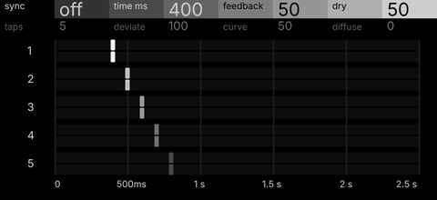
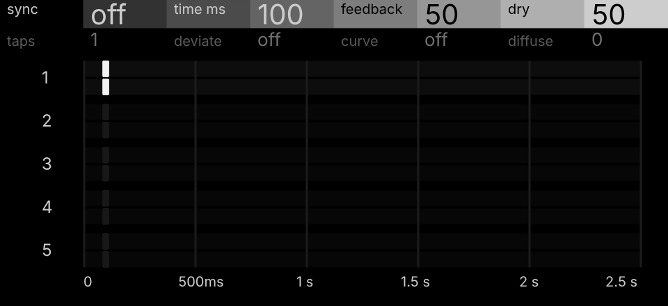
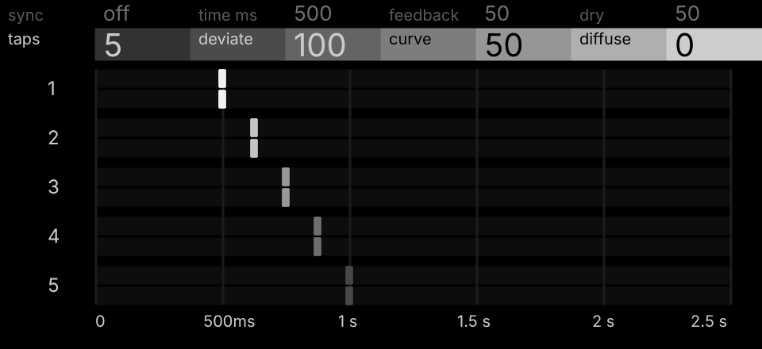
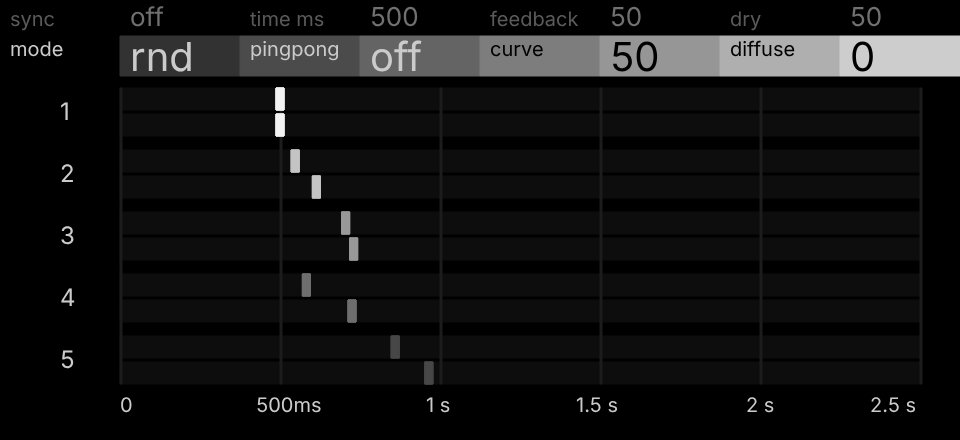
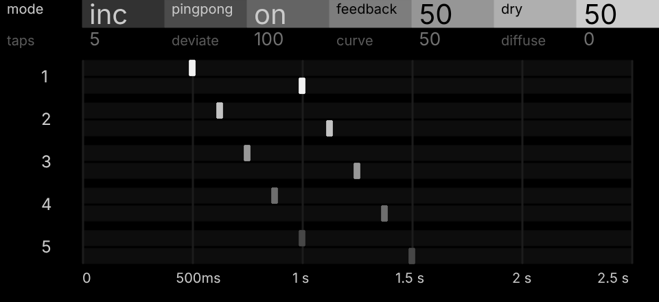
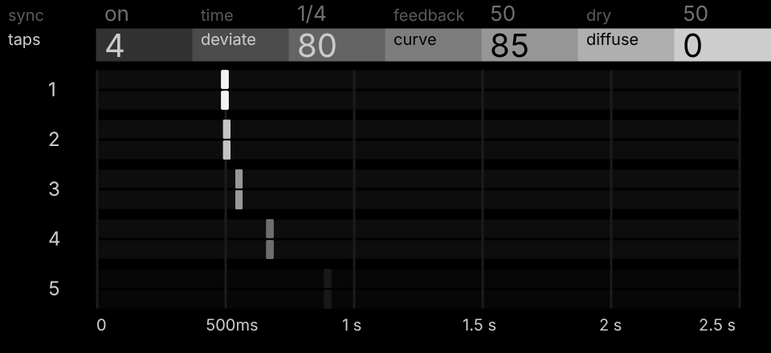

# Comet

A send effect for the OP-XY (Open-XY ID `comet`, shown on the OP-XY as
`comet`), inspired by the Ursa Major Space Station SST-282 and Sabroi's AS
D-Delay.

A delay that morphs between a filter, flanger, chorus, resonator, reverb and
granular smear. Up to five taps per side read a stereo line; Deviate spreads
them evenly or at random, Pingpong bounces the repeats between the sides, and
a diffuser inside the feedback loop smears every repeat a little more each time
round.



| | |
| --- | --- |
|  |  |
| **Defaults:** one tap at 100 ms; Deviate and Curve read off, and the other taps wait on Time | **Inc:** five taps spread evenly by Deviate 100, up to twice Time |
|  |  |
| **Rnd** (Shift + encoder 1): the taps scattered, differently on each side | **Pingpong on** (Shift + encoder 2): the right side shows the bounce, a whole Time later |
|  | |
| **Curve 85:** with Sync on at 1/4, the taps crowd towards Time | |

These are rendered from Comet's own page code (`display.cpp` and
`panel.svg.fragment`), frame for frame what the OP-XY draws; only the font
differs from the device's.


Comet is built on the core Ping Pong (Open-XY contributors, MIT), which is
proven on the OP-XY: its tap reading, its unwritten-sample check, its glide and
its Q31 arithmetic, in one per-sample loop, with Comet's controls on top.

Its page is the two-row header, so Time reads as a note length or in
milliseconds, and under it the taps, in the spirit of AS D-Delay's display: a numbered row
for each tap, its left side above its right, on one fixed timeline, 2.5 s
long and marked every half second (`0 500ms 1 s 1.5 s 2 s 2.5 s`) whatever
Sync and Pingpong are; a tap or bounce past 2.5 s stops at its end. While
Sync is on the page can't know the project tempo, so it places note lengths
at 120 BPM: a beat to each mark. Each tap
is a marker in its own grey, as the OP-XY's screens are monochrome: tap 1
95 %, stepping evenly down to tap 5 at 28 %, so the later taps read as quieter
echoes. Every row's strips are one dark grey; taps that Taps leaves out are a
dimmer grey on a near-black row. (A version with D-Delay's tap colours is kept
in `panel.colour.svg.fragment` for later.) A marker
glides to its tap and smears back over where it was for about 170 ms,
fading slowly in steps (full, 60 %, 30 %) the further back it reaches, so
turning Time, Deviate or Curve blurs the taps as they move. With Pingpong on,
the right side shows the bounce, as D-Delay's right side moves out to twice
Time: the send enters on the left, so the right first hears each of its taps
a whole Time later, and its markers glide out to Time plus their tap (tap 1
to twice Time, the end of the timeline at most). Because synced taps are
placed at 120 BPM, at other tempos they sit on the right beats but the marks'
times are 120 BPM's, and a synced tap the audio stops at 1.43 s (slow tempos)
shows where the note would fall.

| Page | Encoder 1 | Encoder 2 | Encoder 3 | Encoder 4 |
| --- | --- | --- | --- | --- |
| 1 | Sync (off/on) | Time | Feedback | Dry |
| 2 | Taps (1..5) | Deviate | Curve | Diffuse |
| Shift | Mode (Inc/Rnd) | Pingpong (off/on) | | |

Press any encoder to switch all four between the pages. The Shift row works
on either page: **Shift + encoder 1** is Mode, **Shift + encoder 2**
Pingpong, and while Shift is held the header's first two columns show them.
A new project starts both at their first choice, Inc and Off.

- **Sync** chooses what Time means. On: D-Delay's 13 note lengths from `1/32`
  to `1/2` (`1/32 1/16T 1/32D 1/16 1/8T 1/16D 1/8 1/4T 1/8D 1/4 1/2T 1/4D
  1/2`), an equal share of Time's travel each, at the project tempo, read by
  name under `time`. Off: 0.2 ms to 1.4 s, evenly in pitch, read under
  `time ms` (0.2 .. 999) or `time s` (1.00 .. 1.40). Changing either glides
  like tape, as Ping Pong's Size does, so the send's LFO on Time makes a
  flanger or chorus. (With a shift row, Shift + turn no longer gives fine
  steps: Shift chooses Mode and Pingpong.)
- **Time** sets the first tap. Below 50 ms with one tap, Comet turns into a
  Karplus-Strong string: the repeats pass through a two-sample average, which
  darkens each pass, and Feedback reaches much closer to unity (99.95 %), so a
  hit rings as a plucked string at about 44,100 / Time-in-samples Hz. It
  blends in from 50 ms to fully at 20 ms (50 Hz); above 50 ms the echo is unchanged.
- **Dry** is how much of the track's own sound stays as the send rises, read
  by the OP-XY's mixer (`dryParameter`); Comet never mixes dry itself. 50 is
  the default. At 100 the track keeps its full level, as with any send; at 0 and the
  send full, only Comet's repeats are heard.
- **Feedback** returns the repeats, up to 98 % a pass at 100 (50 by default).
  Spread taps sustain about as long as one tap: the loop is scaled for taps
  that add by power once Deviate passes 25, and for taps in phase below that.
  A limiter in the loop holds the repeats under -6 dB, so taps that still add
  up (low notes, close taps) swell and settle like tape instead of clipping.
- **Pingpong** (Shift + encoder 2) is a switch; a new project starts it off. On: a full ping-pong, the send entering on the
  left and every repeat crossing to the other side, so the repeats bounce
  left, right, left at Time apart. Off: each side repeats on its own side.
- **Taps** reads up to five taps; more taps sound about as loud (D-Delay's
  n^-0.368 level).
- **Mode** (Shift + encoder 1) is D-Delay's Inc/Rnd: Inc spreads taps 2..5 evenly, to
  (1 + Deviate x (k/4)^Curve) times Time. Rnd scales each tap's share by a
  random 0..1, drawn apart for each side, exactly as D-Delay does, so a tap
  lands somewhere between Time and its Inc place, and the taps needn't stay
  in order. D-Delay draws new numbers with its Randomize button; Comet's Mode
  runs `inc`, `rnd`, `inc`, `rnd`, ... 254 choices, and each further `rnd` is a
  new draw, so turning on to the next `rnd` randomizes, and turning back
  returns to the draws passed. The 127 draws were all made at random, then
  fixed (keeping only those that reach past .60 on each side and differ
  between the sides), so the choice saved with a project always sounds
  the same and the page always shows the taps you hear.
- **Deviate** is how far Mode spreads the taps, up to twice Time. As in
  D-Delay, which greys Deviate and Mode out with one tap, one tap is a plain
  delay: Deviate and Curve read `off` and they, Mode and the other taps'
  markers do nothing. Deviate at 0, the default, also reads `off`, with Curve.
- **Curve** is D-Delay's: it bends the taps' places in the spread, keeping
  the first and last where they are, by raising each place to a power from
  1/8 to 4 on D-Delay's own scale (1/8 + 31/8 x Curve^2.12655, so most of the
  knob's travel sits near even). 50, the default, is even; above it the taps crowd
  early, so the gaps grow (a slowing echo); below it they crowd late, so the
  gaps shrink (a bouncing ball). Like Deviate and Mode it reads `off` with one
  tap and does nothing.
- **Diffuse** blends in two series of four allpasses per side, from D-Delay's
  input diffusion, inside the feedback loop.

Like every send effect, Comet returns only its repeats; the stock mixer keeps
each track's dry, as Dry sets. The repeats come back at half the send's level, as the core
Ping Pong's do, and linear: nothing is saturated below three quarters of full
scale, and only a runaway loop meets the limit that holds it.

Short times give a comb filter, and with Feedback a resonator; times of 10 to 30
ms with spread taps a chorus; Diffuse at longer times a reverb wash; synced
taps with Diffuse, or scattered with Rnd, a granular smear. The presets (Echo,
Ping Pong, Comb, Resonator, Chorus, Wash, Smear, Scatter) start from each.

### Memory and CPU

The send buffer is the whole 512 KiB a send effect may have (proven on the
OP-XY by the split test), ending in a 2,432-word Q31 diffuser per side.

The lines are two of Q31 samples, 63,104 frames each (1.43 s). A build that
stored 16-bit samples to reach 2.5 s (an earlier long build) sounded distorted on the
device, as did Comet's first builds, which also stored 16 bits.

Taps that would reach further than the line, with Deviate, stop at
its end.

Host estimate from `sdk.py test`, not the device: about 60,000 to 75,000
instructions per block at the heaviest setting (five taps, full Diffuse). The host
emulates Q31 multiplies and saturating adds that are single Blackfin
instructions, so the device should be well below these; published effects
measure 5 to 11 % of the device's 580,352-cycle block budget. Hardware
profiling is still to do.

## Develop

Keep the [SDK](https://github.com/etcetc000/open-xy) beside this repository as
`../open-xy`, on `staging`; adjust the commands if yours is elsewhere. The
[first-machine guide](https://github.com/etcetc000/open-xy/blob/staging/docs/first-machine.md)
covers prerequisites. Read the
[core machines](https://github.com/etcetc000/open-xy-core-machines) as worked
examples and the [machine API](https://github.com/etcetc000/open-xy/blob/staging/docs/api.md)
for the supported interfaces. Follow the
[UX conventions](https://github.com/etcetc000/open-xy/blob/staging/docs/ux.md);
Macro Osc is the two-page reference. Synth starters with five to eight controls
use the [shared header](https://github.com/etcetc000/open-xy/blob/staging/docs/display.md#two-page-header):
keep its SVG block and update the labels/value captions with your controls.
Columns without alternates repeat the same saved parameter on both rows.
Agent instructions are in [AGENTS.md](AGENTS.md).

Effects have no browser preview. Run the host tests below, then audition on your XY
using the hardware workflow linked below.

For synth previews, the workbench's **Graphics** selector compares Colorful and
Grayscale with the same sound and animation code. To control grayscale yourself,
declare SDK 1.5 and `"graphics": {"grayscale": "panel.grayscale.svg.fragment"}`
in machine.json and supply that SVG fragment. Follow the SDK's
[grayscale artwork contract](https://github.com/etcetc000/open-xy/blob/staging/docs/display.md#grayscale-artwork).
Already-grayscale originals remain unchanged; without a variant, the installer
converts colors automatically. Comet draws its own page in greys.

```sh
python ../open-xy/sdk.py test --machine . --cxx clang++ --host-cxx g++
```

Extend `tests/` as the machine's behavior grows. The starter is a minimal
implementation, not a finished instrument. Keep generated output outside this
repository. The generated workflow checks source, sound tests and synth previews
on Linux, and compiles the native module on Windows; it never uses a device.
Its `OPEN_XY_REF` starts at `staging`; pin a compatible SDK commit for a release.

## Hardware and publication

Check the machine on the device with [QA.md](QA.md): one pass, top to bottom,
in one project. Host tests can't hear the sound or see the screen. Keep it in
step with the machine: its controls, and sections for its own behavior.

Follow the SDK's [firmware build guide](https://github.com/etcetc000/open-xy/blob/staging/docs/build.md)
and [hardware profiling workflow](https://github.com/etcetc000/open-xy/blob/staging/docs/profiling.md).
Keep firmware and stock content outside every checkout. Commit the machine,
build with profiling enabled, install when authorized and collect a run
(see its "Collect a run" section). Run `sdk.py profile report` and inspect both
average CPU (`block_percent`) and worst observed block CPU (`peak_percent`).
The peak is the largest measured block across all settings and captures, never
an average of peaks. A clipped peak cannot be published as an exact measurement.
Aim for at most 3.5% of the block budget for both average and peak CPU;
exceeding either recommendation warns but does not reject the submission.
The host estimate printed by `test` cannot substitute for those measurements.

For the builder, follow [catalog submission](https://github.com/etcetc000/open-xy/blob/staging/docs/catalog.md#submit-a-machine).
Every new or changed draft/published entry needs a hardware CPU record tied to
its pinned commit, including average and peak CPU. Copy the complete `cpu` member
from the generated `catalog-cpu.json` into the catalog entry before submitting.
Existing captures can be reprocessed offline to add the peak; no new device run
is needed if the exact source and measured package still match.
Hardware validation may be performed by a maintainer if you
do not own an XY. Publication remains pending until that evidence is available.

Comet is covered by [LICENSE](LICENSE). Its foundation (buffer layout, tap
reading, unwritten-sample check, glide and saturating add) comes from the core
Ping Pong in [open-xy-core-machines](https://github.com/etcetc000/open-xy-core-machines),
Copyright (c) 2026 Open-XY contributors, MIT License. Its design follows AS
D-Delay by Sabroi (sabroi.com): the tap spread (Inc and Rnd), the tap level
curve and the input-diffusion lengths and gains. No D-Delay code is included.
Ask Sabroi before publishing it as a port of D-Delay.
